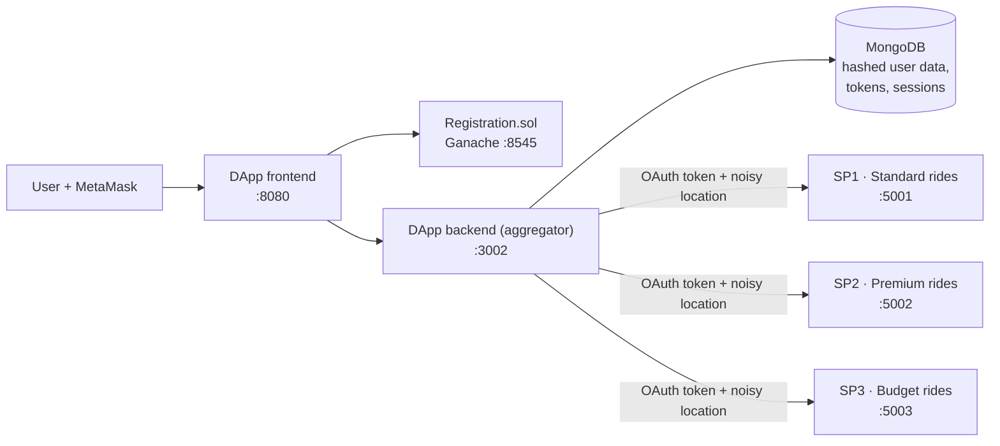

# Privacy-Preserving Ride-Sharing Aggregator (DApp)

A decentralised application that lets a user search several ride-sharing service providers (SPs)
from one place **without handing each provider their identity or exact location**. Identity is
anchored to an Ethereum wallet, providers are accessed through revocable OAuth tokens, personal data
is stored only as hashes, and location queries are protected with **differential privacy
(geo-indistinguishability)**.


## The problem

Aggregator platforms that query many providers on a user's behalf create a privacy risk: each
provider learns who the user is and exactly where they are, and the aggregator becomes a central
store of personal data. This project explores how to keep the convenience of aggregation while
limiting what every party learns.

## Architecture



| Protocol | What happens |
|---|---|
| **Registration** | The user connects a MetaMask wallet and verifies their email. Only the wallet address, flags and timestamps go on-chain via `Registration.sol`; name, email and phone are stored **hashed** off-chain. |
| **Login** | Wallet-based login: the backend checks the wallet's registration and email-verification status. |
| **Permission granting** | The user authorises each SP through an OAuth 2.0 flow. The aggregator stores the access token with its expiry. |
| **Permission revocation** | Revoke one SP or all of them. The tokens are deleted and later queries to that SP stop. |
| **Ride search** | The aggregator opens a session, queries only the SPs the user has authorised, and perturbs the location with **geo-indistinguishability** noise before it leaves the aggregator. |
| **Booking** | Book through an aggregated session. Booking history is kept per wallet. |

## Privacy techniques

- **On-chain minimalism**: the smart contract stores no personal data, only registration and verification state.
- **Hashed PII**: personal fields are stored as salted HMAC-SHA256 hashes, so a database leak does not expose raw identities.
- **Geo-indistinguishability**: a planar-Laplace mechanism (exponential radius, uniform angle,
  clipped maximum displacement) with a configurable privacy budget ε. The `DP_p2/` prototype
  tests this on a real pickup-location dataset from Dhaka.
- **Scoped, revocable access**: each provider gets its own OAuth client and token, which the user can revoke at any time.
- **Session separation**: provider-side session IDs are mapped to aggregator sessions, so providers cannot link queries directly.

## Repository layout

```
contracts/Registration.sol   Smart contract (Solidity 0.8, Truffle)
migrations/                  Truffle deployment
src/                         DApp frontend (MetaMask, Web3)
backend/                     Aggregator API: registration, OAuth tokens, permissions, sessions, bookings
sp1/ sp2/ sp3/               Three mock service providers with OAuth endpoints and DP-protected queries
DP_p2/                       Stand-alone geo-indistinguishability prototype on a location dataset
token generation/            Early OAuth token-exchange prototype
start_all_services.sh        Starts Ganache, the backend, the frontend, the 3 SPs and the OAuth server
test_*.sh                    End-to-end checks (OAuth flow, permissions, revocation, bookings)
```

## Running it locally

**Prerequisites:** Node.js 18+, Truffle, Ganache, the MetaMask browser extension, and a MongoDB instance (local or Atlas).

```bash
# 1. Install dependencies
npm install
(cd backend && npm install) && (cd sp1 && npm install) && (cd sp2 && npm install) && (cd sp3 && npm install)

# 2. Configure each service: copy the example env file and fill in your own values
cp backend/env.example backend/.env
cp sp1/env.example sp1/.env   # repeat for sp2, sp3

# 3. Deploy the contract to Ganache
ganache --port 8545 --deterministic &
truffle migrate --reset

# 4. Start everything
export MONGODB_BASE_URI="mongodb+srv://<user>:<password>@<cluster>.mongodb.net/"
./start_all_services.sh
```

Open <http://localhost:8080> and connect MetaMask to `localhost:8545`. Then register, grant
permissions to the providers, and search for rides. `./test_complete_flow.sh` runs the end-to-end checks.

| Service | URL |
|---|---|
| DApp frontend | http://localhost:8080 |
| Aggregator API | http://localhost:3002 |
| SP1 / SP2 / SP3 | http://localhost:5001 · 5002 · 5003 |
| OAuth server | http://localhost:4000 |
| Ganache | http://localhost:8545 |

Development notes and the test log are in [`PROGRESS_TRACKER.md`](PROGRESS_TRACKER.md).

## Status and next steps

All the protocols above work end to end on a local network. Planned next:
- recording permission grants and revocations on-chain (`setPermission(wallet, sp, bool)`)
- encrypted token storage
- per-user privacy-budget accounting

## Author

**Arnob Sarker Partho** · [GitHub](https://github.com/Arnob-Sarker)

Built on the Truffle starter box (MIT licence, see [`LICENSE`](LICENSE)).
